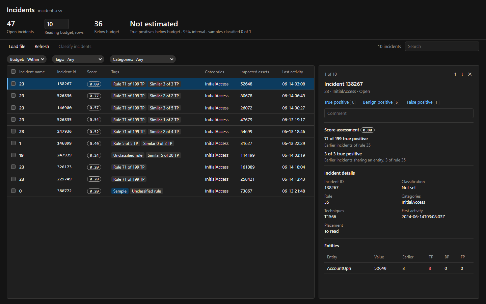

# meerkat

Meerkat ranks a SOC's open incidents so that analysts read the likely true
positives first. It scores each incident from the classifications given to
earlier ones, folds duplicates into one row, and lists as many rows as the team
has time to read. It runs in a terminal or as a local web page. It is a second
opinion beside the SIEM's own queue, built on one signal: how the organisation
classified earlier incidents.


## Install

Python 3.12 or newer.

```bash
git clone https://github.com/jiacwng/meerkat.git
cd meerkat
python3 -m venv .venv && source .venv/bin/activate
python -m pip install -e .
```

## Quick start

The repository ships an example export: one organisation of Microsoft's GUIDE
dataset, with 47 open incidents. Set how many rows you plan to read, then load
the file:

```bash
meerkat config budget 10
meerkat queue examples/incidents.csv
```

This prints the queue in the picture above. It ends with a summary:

```text
OPEN           47 incidents in 46 rows, 10 listed
BELOW BUDGET   36 rows, 1 similar TP, 7 unclassified rule
```

GUIDE replaces names with numbers, so hosts, users and titles are numbers here.

| Column | Meaning |
| --- | --- |
| `SCORE` | Likelihood of a true positive, from 0 to 1. |
| `GROUP` | Open incidents of the same rule with the same devices, accounts, addresses, files and URLs. They take one row. |
| `RULE_TP` | True positives over classified incidents of the same rule. |
| `SIMILAR_TP` | True positives over earlier incidents that share a device, account, address, file or URL. |
| `FLAG` | `sample`: drawn at random from below the budget. `similar TP`: below the budget, with an earlier similar true positive. `unclassified rule`: below the budget, rule never classified. |

## Working through the queue

Look at one incident:

```bash
meerkat details 138267
```

Classify it `tp`, `bp` or `fp`. `--group` classifies every open incident of its group:

```bash
meerkat classify 138267 tp --comment "confirmed with the user"
meerkat classify 138267 tp --group
```


Each classification changes the next queue. Load the next export the same way,
and earlier classifications count for it:

```bash
meerkat queue tomorrow.csv
```

To classify from a file, give a CSV with the columns `IncidentId` and
`IncidentGrade`. `examples/classifications.csv` holds the real classifications
of the 47 example incidents:

```bash
meerkat classify --file examples/classifications.csv
```

## Web page

```bash
meerkat serve
```

This prints an address on 127.0.0.1. The page shows the same queue, with one
incident beside it and the classification buttons. It answers on this machine
only.



## Commands

| Command | What it does |
| --- | --- |
| `meerkat queue [FILE]` | Scores an incident CSV and saves it as a run. Without FILE it lists the open incidents of every saved run. |
| `meerkat details INCIDENT` | Shows one incident: score, entities, group, classification history and similar incidents. |
| `meerkat classify INCIDENT CLASSIFICATION` | Records a classification: `tp`, `bp` or `fp`. |
| `meerkat classify --file FILE` | Records every classification in a CSV. |
| `meerkat budget` | Shows what is below the budget and what the sample says about it. |
| `meerkat serve` | Opens the queue as a web page. |
| `meerkat runs` | Lists the saved runs. |
| `meerkat config [SETTING VALUE]` | Shows the settings, or changes one. |

| Option | Where | What it does |
| --- | --- | --- |
| `--all` | `queue` | Also lists the rows below the budget. |
| `--limit N` | `queue` | Prints the first N rows. |
| `--run ID` | `queue`, `details` | Only the incidents of one run. |
| `--mapping NAME_OR_PATH` | `queue FILE` | Column names of the file, see below. |
| `--group` | `classify` | Classifies the whole group. |
| `--comment TEXT` | `classify` | Text stored with the classification. |
| `--json` | `queue`, `details`, `runs`, `budget` | Machine readable output. |
| `--port N` | `serve` | Port to listen on. |
| `--runs-dir PATH` | all | Where runs, classifications and settings are kept. Default `runs/`. |

Colour is used on a terminal only. Set `NO_COLOR` to turn it off.

## Settings

| Setting | Meaning | Default |
| --- | --- | --- |
| `budget` | Number of rows the team plans to read. | none |
| `sample_share` | Share of the budget drawn at random from below it. | 0.1 |

```bash
meerkat config
meerkat config budget 10
meerkat config sample_share 0.2
```

The sample exists to check the budget. Once sample rows are classified,
`meerkat budget` gives a 95% interval for the true positives left below it:

```text
BUDGET                10 rows
BELOW BUDGET          35 rows, 35 incidents
  similar TP          1
  unclassified rule   4
  oldest below        06-12 21:10
SAMPLE                1 drawn, 1 classified, 0 TP
TP BELOW BUDGET       0 to 31 of 35, 95% interval, from 1 classified
```

## Your own data

Meerkat reads a CSV with one row per alert, for one organisation, with
ISO 8601 times. It needs three columns: an incident id, a time and a rule id.
A classification column gives it history. Columns for devices, accounts,
addresses, files and URLs feed the similar incident inputs; without them the
score uses rule and organisation history only. The default column names are
those of the GUIDE dataset.

`--mapping` names the columns and classification words of another source. The
presets are `defender`, `sentinel` and `splunk`, or give a TOML file:

```bash
meerkat queue export.csv --mapping sentinel
meerkat queue export.csv --mapping site.toml
```

```toml
[columns]
IncidentId = "case_id"
Timestamp = "opened_at"
DetectorId = "rule"
IncidentGrade = "outcome"

[classifications]
TruePositive = ["confirmed"]
open = ["new", "in progress"]
```

A column or classification left out keeps its default name.

## How it works

The score is a logistic regression on eight inputs, all taken from incidents
earlier in time: how often the rule and the organisation were classified true
positive, and how often the incidents sharing an entity were. The weights ship
with the package and were fitted on Microsoft's GUIDE dataset. On the later
40% of GUIDE, the mean average precision over 718 organisations is 0.72,
against 0.65 for rule and organisation history alone. `bench/train.py`
reproduces both figures.

## Limits

- The score uses classification history only. It has no severity and no asset
  criticality.
- It was measured on GUIDE, one vendor's data from 2024, and not in a live SOC.
- The sample is small at a small budget, so the interval is wide.
- The `sentinel` and `splunk` presets were written from vendor documentation
  and have not read a real export. Sentinel's `SecurityIncident` table has no
  entity columns, so that preset gives rule and organisation history only.

## License

MIT. `examples/` is derived from GUIDE under CDLA Permissive 2.0, see `NOTICE`.
