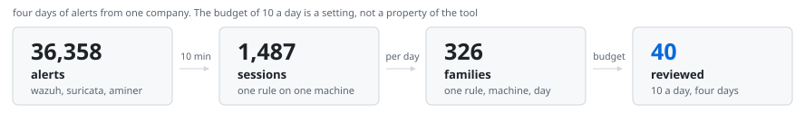

<p align="center">
  
</p>

<h1 align="center">meerkat</h1>

<p align="center">
  <strong>End-of-day alert triage for Wazuh.</strong>
</p>

<p align="center">
  <a href="https://github.com/jiacwng/meerkat/actions/workflows/ci.yml">
    
  </a>
  
  
</p>

<p align="center">
  <a href="#quick-start">Quick start</a>
  &nbsp;&middot;&nbsp;
  <a href="docs/manual.md">Manual</a>
  &nbsp;&middot;&nbsp;
  <a href="#results">Results</a>
</p>

## Overview

Meerkat ranks a finished day of Wazuh alerts into a short review queue for the
next morning. It groups the alerts by rule and machine, scores each group, and
lists the top items for an analyst to work in the terminal.

It reads Wazuh alerts, including the Suricata alerts in the Wazuh feed. AMiner,
a log anomaly detector, is an optional second source.

## Quick start

Python 3.12 or newer, and Git LFS for the bundled example alerts.

```bash
git clone https://github.com/jiacwng/meerkat.git
cd meerkat
git lfs install && git lfs pull
python3 -m venv .venv && source .venv/bin/activate
python -m pip install -e .
meerkat demo
```

The clone holds a trained model and one company's alerts from the AIT Alert
Data Set, under CC BY 4.0 ([NOTICE](NOTICE)). The model never trained on this
company. Its queue for the first day, from `meerkat queue --day 2022-01-21`:

```text
run russellmitchell-20261007-134440-786  |  company russellmitchell  |  budget 10  |  326 families
Review queue (top 10 per day, 2022-01-21)  |  F1 = top priority
┏━━━━━━━━┳━━━━━━━━━━━━┳━━━━━━━┳━━━━━━━━━━━━━━━━━┳━━━━━━━━━━┳━━━━━━━━━━┳━━━━━━━━━━━━━━━━━━━━━━━━━━━━━━━━━━━━━━━━━━┳━━━━━━━━━━━━━━━━━━━━━━━━━━━━━┳━━━━━━━━┳━━━━━━━┳━━━━━━━┳━━━━━━━━━┳━━━━━━━━┓
┃ handle ┃ date       ┃ start ┃ host            ┃ crit     ┃ detector ┃ finding                                  ┃ why                         ┃ alerts ┃ chain ┃ score ┃    esc% ┃ review ┃
┡━━━━━━━━╇━━━━━━━━━━━━╇━━━━━━━╇━━━━━━━━━━━━━━━━━╇━━━━━━━━━━╇━━━━━━━━━━╇━━━━━━━━━━━━━━━━━━━━━━━━━━━━━━━━━━━━━━━━━━╇━━━━━━━━━━━━━━━━━━━━━━━━━━━━━╇━━━━━━━━╇━━━━━━━╇━━━━━━━╇━━━━━━━━━╇━━━━━━━━┩
│ F1     │ 2022-01-21 │ 06:33 │ inet-firewall   │ critical │ AMiner   │ AMiner: Unusual occurrence frequencies o │ asset role firewall         │      6 │     2 │  1.00 │         │        │
│ F2     │ 2022-01-21 │ 11:27 │ inet-firewall   │ critical │ AMiner   │ AMiner: New service_start parameter comb │ asset role firewall         │      1 │     2 │  0.96 │         │        │
│ F3     │ 2022-01-21 │ 11:27 │ inet-firewall   │ critical │ AMiner   │ AMiner: New service_stop parameter combi │ asset role firewall         │      1 │     2 │  0.96 │         │        │
│ F4     │ 2022-01-21 │ 00:00 │ inet-firewall   │ critical │ AMiner   │ AMiner: New ip address in DNS logs.      │ asset role firewall         │     16 │     2 │  0.65 │         │        │
│ F5     │ 2022-01-21 │ 16:10 │ inet-firewall   │ critical │ Suricata │ SURICATA HTTP gzip decompression failed  │ asset role firewall         │      1 │       │  0.50 │         │        │
│ F6     │ 2022-01-21 │ 06:37 │ webserver       │ high     │ Suricata │ SURICATA TLS invalid record/traffic      │ detectors within 10 minutes │    105 │     1 │  0.20 │         │        │
│ F7     │ 2022-01-21 │ 06:37 │ webserver       │ high     │ Suricata │ SURICATA TLS invalid handshake message   │ detectors within 10 minutes │    105 │     1 │  0.18 │         │        │
│ F8     │ 2022-01-21 │ 06:33 │ intranet-server │ high     │ Suricata │ ET POLICY GNU/Linux APT User-Agent Outbo │ detectors within 10 minutes │      7 │     2 │  0.16 │         │        │
│ F9     │ 2022-01-21 │ 16:06 │ inet-firewall   │ critical │ Suricata │ SURICATA HTTP unable to match response t │ asset role firewall         │      8 │       │  0.16 │         │        │
│ F10    │ 2022-01-21 │ 06:37 │ mail            │ high     │ Suricata │ SURICATA TLS invalid record/traffic      │ detectors within 10 minutes │    105 │     1 │  0.15 │         │        │
└────────┴────────────┴───────┴─────────────────┴──────────┴──────────┴──────────────────────────────────────────┴─────────────────────────────┴────────┴───────┴───────┴─────────┴────────┘
```

`score` sets the order. `why` names the largest contribution to the score,
`crit` is the asset's criticality, and `chain` is the length of the host's
ATT&CK chain that day. `esc%` and `review` fill in as you record decisions.

One pass from scoring to review and export:

<p align="center">
  
</p>

## Usage

Alerts land in a new folder each day, so set the environment and the inventory
once in `meerkat.toml`:

```toml
environment = "acme"
inventory = "inventory/acme.json"
```

```bash
meerkat inventory --input alerts/2026-10-05 --out inventory/acme.json  # once
meerkat check --input alerts/2026-10-05      # what triage will see
meerkat pull --day 2026-10-06 --input alerts/2026-10-06  # each morning, yesterday
meerkat triage --input alerts/2026-10-06     # score the day into a run
meerkat browse                               # work the queue, record decisions
meerkat export decisions                     # the review pass as a grid
meerkat retrain --incidents tickets.csv      # refit on your own history
```

`inspect` opens any family, session or alert with its evidence and ATT&CK
techniques. `export navigator` writes an ATT&CK Navigator layer. The
[manual](docs/manual.md) covers every command, flag and input format.

## How it works

- A **session** is one rule firing on one machine until it is quiet for ten
  minutes.
- A **family** joins the same day's sessions that share a machine, a detector
  and a rule. One family is one item in the queue.
- A random forest scores each session, and a logistic regression ranks each
  family from its sessions.
- The top families of each day form the queue. The budget is 10 a day by
  default.

<p align="center">
  
</p>

`retrain` refits the forest on a company's own incident records. It saves the
new model when it reaches every incident the shipped one reaches and leaves
no larger share of alerts on rules it never saw.

## Results

Measured on the [AIT Alert Data Set](https://zenodo.org/records/8263181):
eight simulated company networks attacked by one scripted attack, with every
alert labelled. The model trains on seven networks and is scored on the eighth.

| Ranking method | steps reached, 5 a day | steps reached, 10 a day | alerts behind 10 items, per day |
|---|---:|---:|---:|
| **Meerkat** | **53** | **58** | **14,660** |
| Forest score of the best session | 43 | 51 | 38,487 |
| Random order | 24 | 38 | 2,803 |
| Detectors' own severity | 19 | 33 | 4,542 |

A step is one phase of the scripted attack on one machine, reached when the
queue holds an alert labelled to it. 60 of the 79 steps are findable at all.
At five items a day, Meerkat reaches 53 and the forest alone reaches 43, on
every seed. At ten, the two are close and Meerkat queues fewer alerts. Full
tables and every baseline: [bench/README.md](bench/README.md).

The busiest test day, 453,697 alerts, triages in 72 seconds with 1.1 GB of
memory.

## Limitations

- The results come from one simulated testbed whose eight networks share an
  attack script. The model may partly learn that script: which rules it fires
  and which machine roles it targets. Nothing here shows how the tool performs
  in production.
- A new site starts with the shipped model, which has seen only the testbed's
  rules. When more than 20% of a day's alerts come from rules it has not seen,
  `check` and `triage` warn that the ranking is close to arbitrary until a
  retrain. Retraining needs a record of past incidents.
- The model reads 16 asset roles taken from the testbed. Other roles in the
  inventory add nothing to the score, and `check` names them.
- A run covers one complete day in UTC.
- An attack that fires the same rule as everyday noise, at the same severity
  and the same hours, ranks with the noise.
- Criticality and ATT&CK tactics are shown and filtered on, and never change
  the score. The ATT&CK mapping was built from the test data.
- Wazuh, Suricata and AMiner are supported. Another detector needs an adapter.

## License

MIT, see [LICENSE](LICENSE). [NOTICE](NOTICE) carries the AIT and MITRE ATT&CK
attributions, and `CITATION.cff` the data set references.
