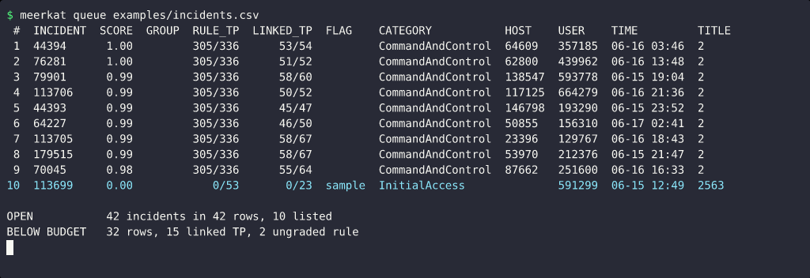
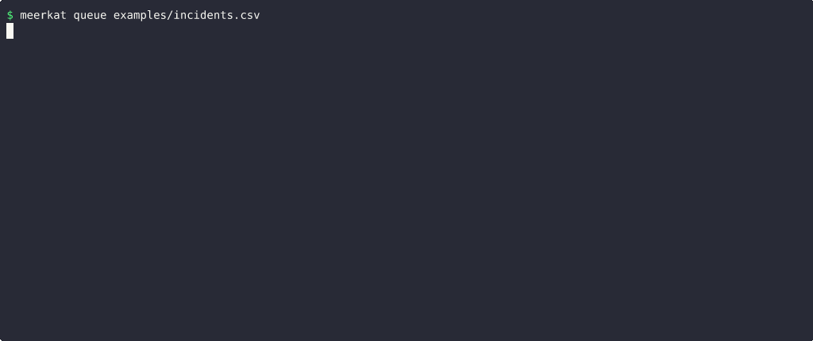

# meerkat

Meerkat ranks a SOC's open incidents so that analysts read the likely true
positives first. It scores each incident from the classifications given to
earlier ones, folds duplicates into one row, and lists as many rows as the team
has time to read. Analysts work in a local web page, and every step is also a
command for scripts. It is a second opinion beside the SIEM's own queue, built
on one signal: how the organisation classified earlier incidents.


## Install

Python 3.12 or newer.

```bash
git clone https://github.com/jiacwng/meerkat.git
cd meerkat
python3 -m venv .venv && source .venv/bin/activate
python -m pip install -e .
```

## Quick start

```bash
meerkat serve examples/incidents.csv
```

This opens the queue in your browser. The example is one organisation of
Microsoft's GUIDE dataset, with 47 open incidents. Type 10 in `Reading budget` to list
the ten rows you plan to read. GUIDE replaces names with numbers, so hosts,
users and titles are numbers here.

| Column | Meaning |
| --- | --- |
| `Score` | Likelihood of a true positive, from 0 to 1. |
| `Tags` | `Rule 71 of 199 TP` counts true positives among classified incidents of the same rule. `Similar 3 of 3 TP` counts them among earlier incidents sharing a device, account, address, file or URL. `Unclassified rule`: the rule was never classified. `Group of 2`: open incidents of one rule with the same entities, in one row. `Sample`: drawn at random from below the budget. |

## Working through the queue

Select a row to see the incident beside the queue. Classify it with the
buttons or with the keys `t`, `b` and `f`. The keys `j` and `k` move between
rows. `Group of N` classifies every open incident of its group. Tick several
rows and press `Classify incidents` to classify them together. Each
classification changes the queue at once.

To load the next export, press `Load file` or drop the CSV on the page.
Earlier classifications count for it.

## Checking the budget

Part of the budget is drawn at random from below it and tagged `Sample`.
Once sample rows are classified, the page gives a 95% interval for the true
positives left unread. In the example, one classified sample gives 0 to 31
of 35.

## Your own data

Meerkat reads three kinds of CSV and tells them apart by their header: the
incident queue export of the Microsoft Defender portal, which also holds
Microsoft Sentinel incidents; a Splunk Enterprise Security search export with
the notable event fields `rule_id`, `_time` and `rule_name`, and optionally
`rule_title`, `security_domain`, `disposition_label`, `src`, `dest` and
`user`; and meerkat's own columns, those of the GUIDE dataset, `IncidentId`,
`Timestamp` and `DetectorId`, with `IncidentGrade` for history. A word or
column meerkat does not know stops the load with its name and row. Devices,
accounts, addresses, files and URLs feed the similar incident inputs; without
them the score uses rule and organisation history only.

```bash
meerkat queue incidents-queue-20261125.csv
```

## How it works

The score is a logistic regression on eight inputs, all taken from incidents
earlier in time: how often the rule and the organisation were classified true
positive, and how often the incidents sharing an entity were. The weights ship
with the package and were fitted on Microsoft's GUIDE dataset. On the later
40% of GUIDE, the mean average precision over 718 organisations is 0.72,
against 0.65 for rule and organisation history alone. `bench/train.py`
reproduces both figures.

## Limits

- The score uses classification history only. It has no severity and no asset
  criticality.
- It was measured on GUIDE, one vendor's data from 2024, and not in a live SOC.
- The sample is small at a small budget, so the interval is wide.
- The Defender reader was written from the portal's code and one real export
  with no classified incident. The Splunk reader was tested on rows built in a
  local Splunk without Enterprise Security. Neither has read a classified export
  from a live SOC. The Defender export lists devices and accounts only.

## Scripts

Set how many rows you plan to read, then load the file:

```bash
meerkat config budget 10
meerkat queue examples/incidents.csv
```



This prints the queue in the picture above. It ends with a summary:

```text
OPEN           47 incidents in 46 rows, 10 listed
BELOW BUDGET   36 rows, 1 similar TP, 7 unclassified rule
```

Look at one incident:

```bash
meerkat details 138267
```

Classify it `tp`, `bp` or `fp`. `--group` classifies every open incident of its group:

```bash
meerkat classify 138267 tp --comment "confirmed with the user"
meerkat classify 138267 tp --group
```



Each classification changes the next queue. Load the next export the same way,
and earlier classifications count for it:

```bash
meerkat queue tomorrow.csv
```

To classify from a file, give a CSV with the columns `IncidentId` and
`IncidentGrade`. `examples/classifications.csv` holds the real classifications
of the 47 example incidents:

```bash
meerkat classify --file examples/classifications.csv
```

| Command | What it does |
| --- | --- |
| `meerkat serve [FILE]` | Opens the queue as a web page on 127.0.0.1. With FILE it loads the file first. |
| `meerkat queue [FILE]` | Scores an incident CSV and saves it as a run. Without FILE it lists the open incidents of every saved run. |
| `meerkat details INCIDENT` | Shows one incident: score, entities, group, classification history and similar incidents. |
| `meerkat classify INCIDENT CLASSIFICATION` | Records a classification: `tp`, `bp` or `fp`. |
| `meerkat classify --file FILE` | Records every classification in a CSV. |
| `meerkat budget` | Shows what is below the budget and what the sample says about it. |
| `meerkat runs` | Lists the saved runs. |
| `meerkat config [SETTING VALUE]` | Shows the settings, or changes one. |

| Option | Where | What it does |
| --- | --- | --- |
| `--all` | `queue` | Also lists the rows below the budget. |
| `--limit N` | `queue` | Prints the first N rows. |
| `--run ID` | `queue`, `details` | Only the incidents of one run. |
| `--group` | `classify` | Classifies the whole group. |
| `--comment TEXT` | `classify` | Text stored with the classification. |
| `--json` | `queue`, `details`, `runs`, `budget` | Machine readable output. |
| `--port N` | `serve` | Port to listen on. |
| `--max-file-mb N` | `serve` | Largest file the page may load, in megabytes. Default 200. |
| `--no-browser` | `serve` | Does not open the browser. |
| `--runs-dir PATH` | all | Where runs, classifications and settings are kept. Default `runs/`. |

Colour is used on a terminal only. Set `NO_COLOR` to turn it off.

| Setting | Meaning | Default |
| --- | --- | --- |
| `budget` | Number of rows the team plans to read. | none |
| `sample_share` | Share of the budget drawn at random from below it. | 0.1 |

```bash
meerkat config
meerkat config budget 10
meerkat config sample_share 0.2
```

Once sample rows are classified, `meerkat budget` gives the same interval as
the page:

```text
BUDGET                10 rows
BELOW BUDGET          35 rows, 35 incidents
  similar TP          1
  unclassified rule   4
  oldest below        06-12 21:10
SAMPLE                1 drawn, 1 classified, 0 TP
TP BELOW BUDGET       0 to 31 of 35, 95% interval, from 1 classified
```

## License

MIT. `examples/` is derived from GUIDE under CDLA Permissive 2.0, see `NOTICE`.
